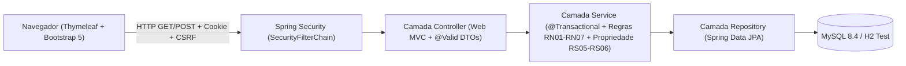
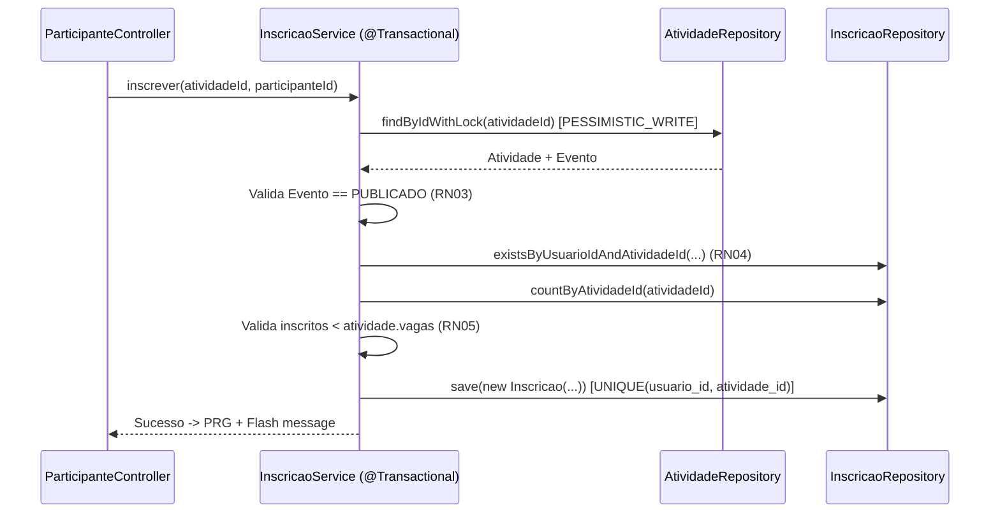

# Arquitetura do Sistema — EventIF

## 1. Estilo Arquitetural e Camadas (`RT01`)

O EventIF é uma aplicação web monolítica server-side construída em **Java 21 + Spring Boot 3.x**, utilizando **Spring MVC + Thymeleaf** para renderização HTML no servidor, **Spring Security 6** para autenticação/autorização e **Spring Data JPA / Hibernate** sobre **MySQL 8.4** (e H2 em testes).



### Regras entre Camadas
- **Controller:** recebe requisições HTTP, realiza validação sintática via `@Valid` + `BindingResult` (`RT03`, `RI02`), extrai a identidade do usuário autenticado via `@AuthenticationPrincipal` / `SecurityService` (`RS06`), delega ao `service`, adiciona `RedirectAttributes` (`RI03`) e retorna o nome da view Thymeleaf ou `redirect:` (padrão **Post-Redirect-Get**). **Não contém regras de negócio nem acessa `Repository` diretamente.**
- **Service:** unidade transacional (`@Transactional`), concentra integralmente `RN01`–`RN07`, verifica propriedade de recursos (`RS05`–`RS06`), aplica locks concorrentes quando necessário e mapeia entidades para View DTOs (evitando `LazyInitializationException` e vazamento de dados sensíveis nas views).
- **Repository:** interfaces `JpaRepository` com queries derivadas (`RT02`) e consultas JPQL específicas (`JOIN FETCH`, paginação com `Page<Evento>`, lock pessimista com `@Lock(LockModeType.PESSIMISTIC_WRITE)`).

---

## 2. Estrutura de Pacotes (`br.edu.ifce.eventif`)

```text
src/main/java/br/edu/ifce/eventif/
├── EventifApplication.java
├── config/          # SecurityConfig, TimeConfig (Clock bean), DataInitializer (RS07/RT04)
├── controller/      # HomeController, AuthController, ParticipanteController,
│                    # OrganizadorEventoController, OrganizadorAtividadeController,
│                    # AdminCategoriaController, AdminUsuarioController
├── dto/             # Form DTOs (CadastroUsuarioForm, CategoriaForm, EventoForm, AtividadeForm)
│                    # e View DTOs (EventoDetalheView, AtividadeComVagasView, MinhaInscricaoView,
│                    # MinhaListaEsperaView, InscritoPresencaView, CertificadoView, UsuarioResumoView)
├── entity/          # Usuario, Perfil, Categoria, Evento, Atividade, Inscricao, ListaEspera (EX01)
├── enums/           # StatusEvento, TipoAtividade
├── exception/       # RegraNegocioException, AcessoNegadoPropriedadeException,
│                    # RecursoNaoEncontradoException, GlobalExceptionHandler
├── repository/      # UsuarioRepository, PerfilRepository, CategoriaRepository,
│                    # EventoRepository, AtividadeRepository, InscricaoRepository, ListaEsperaRepository
├── security/        # CustomUserDetails, CustomUserDetailsService, SecurityService
├── service/         # UsuarioService, CategoriaService, EventoService,
│                    # AtividadeService, InscricaoService, CertificadoService, CertificadoPdfService
└── validation/      # Validadores customizados e grupos Jakarta Bean Validation
```

---

## 3. Mapa de Rotas, Segurança e Templates (`RS04` + Matriz de Acesso)

| Prefixo / Rota | Método(s) | Permissão no Servidor | Controller | Template(s) |
|---|---|---|---|---|
| `/`, `/eventos`, `/eventos/{id}` | `GET` | `permitAll()` | `HomeController` | `publico/index.html`, `publico/evento-detalhe.html` |
| `/login` | `GET`, `POST` | `permitAll()` | `AuthController` / Spring Security | `auth/login.html` |
| `/cadastro` | `GET`, `POST` | `permitAll()` | `AuthController` | `auth/cadastro.html` |
| `/logout` | `POST` | Autenticado (CSRF) | Spring Security | Redireciona para `/login?logout` |
| `/css/**`, `/js/**`, `/images/**`, `/webjars/**` | `GET` | `permitAll()` | Recursos estáticos | `static/` |
| `/inscricoes` | `GET` | `hasRole("PARTICIPANTE")` | `ParticipanteController` | `participante/minhas-inscricoes.html` |
| `/inscricoes/atividades/{atividadeId}` | `POST` | `hasRole("PARTICIPANTE")` | `ParticipanteController` | Redireciona para `/eventos/{eventoId}` |
| `/inscricoes/atividades/{atividadeId}/espera` | `POST` | `hasRole("PARTICIPANTE")` | `ParticipanteController` | Redireciona para `/eventos/{eventoId}` (`EX01`) |
| `/inscricoes/{inscricaoId}/cancelar` | `POST` | `hasRole("PARTICIPANTE")` | `ParticipanteController` | Redireciona para `/inscricoes` |
| `/inscricoes/espera/{listaEsperaId}/cancelar` | `POST` | `hasRole("PARTICIPANTE")` | `ParticipanteController` | Redireciona para `/inscricoes` (`EX01`) |
| `/certificados/eventos/{eventoId}` | `GET` | `hasRole("PARTICIPANTE")` | `ParticipanteController` | `participante/certificado.html` |
| `/certificados/eventos/{eventoId}/pdf` | `GET` | `hasRole("PARTICIPANTE")` | `ParticipanteController` | Download PDF A4 (`EX03`) |
| `/organizador/eventos/**` | `GET`, `POST` | `hasRole("ORGANIZADOR")` + dono | `OrganizadorEventoController`, `OrganizadorAtividadeController` | `organizador/eventos.html`, `evento-form.html`, `atividades.html`, `inscritos.html` |
| `/admin/categorias/**` | `GET`, `POST` | `hasRole("ADMIN")` | `AdminCategoriaController` | `admin/categorias.html` |
| `/admin/usuarios/**` | `GET`, `POST` | `hasRole("ADMIN")` | `AdminUsuarioController` | `admin/usuarios.html` |
| Demais rotas (`anyRequest()`) | Qualquer | `authenticated()` | — | `error/403.html`, `error/404.html` |

> **Importante (`RS04` vs. `RF11`):** As ações de inscrição (`/inscricoes/**`) e certificado (`/certificados/**`) ficam intencionalmente fora de `/eventos/**` para que visitantes anônimos sejam redirecionados para `/login` e usuários sem `ROLE_PARTICIPANTE` recebam HTTP 403 conforme a Matriz de Acesso da especificação.

---

## 4. Fluxos Arquiteturais Críticos

### 4.1 Proteção contra IDOR e Controle de Propriedade (`RS05`, `RS06`)
1. **Módulo do Organizador:** todo serviço de leitura ou mutação recebe o `organizadorId` obtido da sessão (`SecurityService.getUsuarioAutenticadoId()`).
   - `EventoService` busca o `Evento`; se `evento.organizador.id != organizadorId`, lança `AcessoNegadoPropriedadeException`, mapeada no `GlobalExceptionHandler` para resposta **HTTP 403 Forbidden** com página `error/403.html`.
   - `AtividadeService` e `InscricaoService` (chamada de presença) validam tanto a relação hierárquica (`atividade.evento.id == eventoId`) quanto o dono do evento (`evento.organizador.id == organizadorId`), garantindo que adulteração de qualquer ID na URL retorne **HTTP 403**.
2. **Módulo do Participante:** `InscricaoService` e `CertificadoService` recebem sempre o `participanteId` vindo da sessão autenticada. O cancelamento consulta explicitamente `inscricaoRepository.findByIdAndUsuarioId(inscricaoId, participanteId)` (ou verifica `inscricao.usuario.id == participanteId`), impedindo que um participante cancele ou visualize registros de terceiros.

### 4.2 Concorrência em Inscrições e Limite de Vagas (`RN03`, `RN04`, `RN05`)

- O `@Lock(LockModeType.PESSIMISTIC_WRITE)` serializa transações concorrentes sobre a mesma `Atividade`, evitando corrida na última vaga.
- A constraint de banco `UNIQUE(usuario_id, atividade_id)` atua como segunda barreira definitiva contra duplicidade (`RN04`).

### 4.3 Máquina de Estados do Evento e Validação Temporal (`RN02`, `RN06`, `RF06`)
- Transições permitidas: `RASCUNHO → PUBLICADO → ENCERRADO`.
- Eventos `ENCERRADO` são bloqueados contra edição/exclusão estrutural e contra novas inscrições (`RN03`), garantindo integridade dos certificados (`RF14`/`RN07`).
- Registro de presença (`RF08`) é permitido em eventos `PUBLICADO` ou `ENCERRADO` (bloqueado em `RASCUNHO`).
- Um bean `java.time.Clock` injetado nos services permite testar deterministicamente `RN06` (`agora.isBefore(atividade.getInicio())`) sem dependência de horário real da máquina.

### 4.4 Funcionalidades Extras Implementadas (`EX01`–`EX04`)
Os extras opcionais foram implementados na Fase 15 após a auditoria aprovada dos requisitos obrigatórios:
- **`EX01` (Lista de Espera FIFO):** entidade dedicada `ListaEspera` (`uk_lista_espera_usuario_atividade`) mantendo `RN05` intacto para inscrições diretas; quando `vagasRestantes == 0`, o participante ingressa explicitamente via `POST /inscricoes/atividades/{atividadeId}/espera`. Ao cancelar uma inscrição válida (`RN06`), o `InscricaoService` adquire lock `PESSIMISTIC_WRITE` na `Atividade`, remove a inscrição e promove automaticamente o primeiro candidato elegível ordenado por `dataHora ASC, id ASC` (pulando quem tiver choque de horário por `EX02`).
- **`EX02` (Choque de Horário):** verificação no `InscricaoService` antes de concluir inscrição, entrada em lista de espera ou promoção FIFO via `InscricaoRepository#findConflitosDeHorario` (`a.inicio < :fim AND :inicio < a.fim`, permitindo intervalos adjacentes).
- **`EX03` (Certificado em PDF):** geração A4 paisagem via OpenPDF `1.3.43` em `CertificadoPdfService`, consumindo o `CertificadoView` validado por `CertificadoService` (`RN07`).
- **`EX04` (Testes JUnit das Regras de Negócio):** suíte consolidada com `48` testes em `14` classes JUnit.
